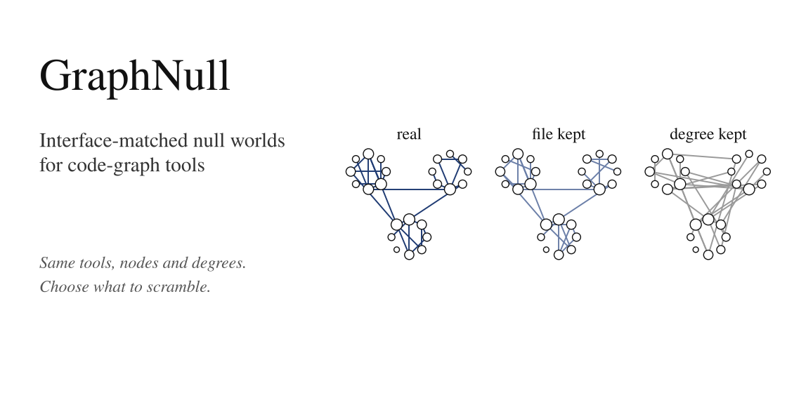
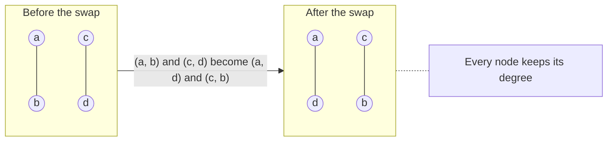
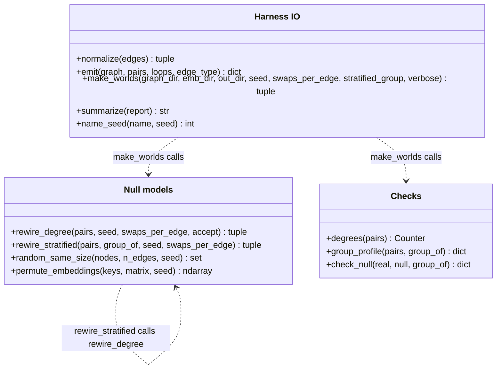
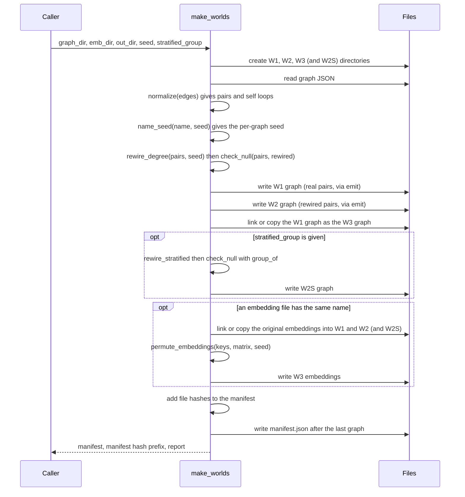
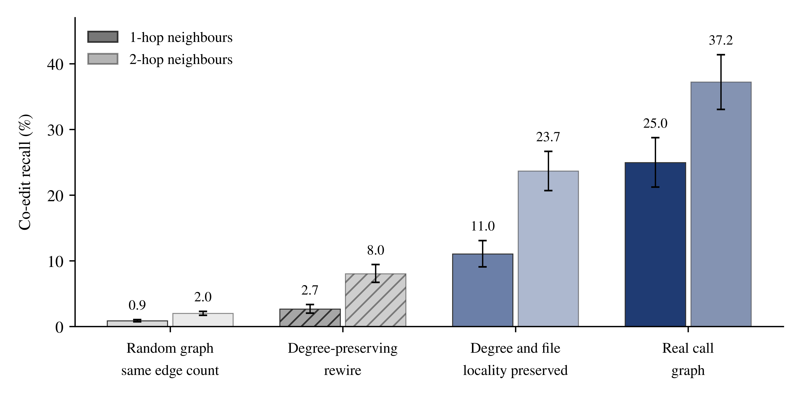

# GraphNull

**Interface-matched null worlds for testing code-graph tools**

Yerramsetty Sai Venkata Suchita, Manjunath Mailey, Kanuma Jagan Mohan

[](LICENSE)
[](pyproject.toml)
[](tests/test_graphnull.py)

<p align="center">
  
</p>

GraphNull writes null worlds for code-graph tools. A null world looks the same to an agent as the real one, with the same tool names, node set, output format and node degrees, and scrambles only the information a claim depends on. If an agent does as well in the null world as in the real one, the gain cannot be credited to that information. The full writeup is [paper/graphnull_writeup.md](paper/graphnull_writeup.md).

## Why

Coding agents are now routinely given call graphs and embedding search, and papers report that these tools improve localization and repair. Those gains are usually measured by switching the tool on and off. That switch also changes the prompt and the tool list, gives the agent a way to turn a bare name into a full symbol, and changes how the agent spends its turns, so the edges of the graph are only one of several differences. Network science has handled the same problem for two decades with randomized graphs that hold chosen statistics fixed [1, 2, 3, 4], and randomization tests showed that some saliency maps did not depend on the model they claimed to explain [5]. GraphNull packages that control for agent harnesses, so that every difference between a real world and its null is a difference in content.

## Install

```
pip install git+https://github.com/yerramsettysuchita/graphnull
```

Or copy [graphnull.py](graphnull.py) into your project. numpy is the only dependency. GraphNull works on Linux, macOS, Windows and Kaggle with Python 3.9 or later.

**Versions.** 1.0.0 is the exact file used in the Map or Ritual study and is the one embedded in the Kaggle notebooks [graphnull-competition-check](https://www.kaggle.com/code/suchitayerramsetty/graphnull-competition-check) and [graphnull-ladder](https://www.kaggle.com/code/suchitayerramsetty/graphnull-ladder). 1.0.1 adds the Windows copy fallback. Null models, seeds, worlds and manifest hashes are identical. See [CHANGELOG.md](CHANGELOG.md).

## Quick start

A complete run is three lines.

```
import graphnull as gn
manifest, digest, report = gn.make_worlds("graphs", "embeddings", "worlds", stratified_group=lambda n: n.rsplit(".", 1)[0])
print(gn.summarize(report), digest)
```

`graphs` holds one JSON graph per repository with `nodes` and `edges` (`source`, `target`, `type`), and `embeddings` holds one `.npz` file per repository keyed by node id, as in the Gemma 4 Developer Agent harness. `worlds` receives the directories `W1`, `W2`, `W3` and `W2S` and a `manifest.json`. The same run from the command line is

```
python graphnull.py graphs embeddings worlds --stratify-by-file
```

The flag `--stratify-by-file` groups nodes by the module part of their id, the text before the last dot.

For a single graph, the null models take a pair set and a seed, and `check_null` reports which invariants hold.

```python
import graphnull as gn

edges = [("a", "b"), ("b", "c"), ("c", "d"), ("d", "e"), ("e", "f"), ("f", "a"), ("a", "d"), ("b", "e")]
pairs, loops = gn.normalize(edges)
null, share_done = gn.rewire_degree(pairs, seed=gn.name_seed("toy"))
print(gn.check_null(pairs, null))  # same_edge_count, degree_preserved, edges_changed
```

## The four nulls

Each null fixes a set of invariants and randomizes the rest.

**What each null keeps.**

|Null|Nodes and edge count|Every node's degree|Per-file neighbour counts|Embeddings|
|---|---|---|---|---|
|Random|kept|changed|changed|kept|
|Degree|kept|kept|changed|kept|
|Stratified|kept|kept|kept|kept|
|Permuted|kept|kept|kept|shuffled|

The degree null uses double-edge swaps [1], ten per edge by default. A swap is skipped if it would create a self loop or a duplicate edge.



The stratified null accepts a swap only when a and c share a group and b and d share a group, so every node also keeps its count of neighbours in every group, in the spirit of degree-corrected block models [4]. With the source file as the group, it keeps file locality and scrambles which function in the file is called. The random null keeps only the node set and the edge count, and the permuted null keeps the graph and shuffles embedding vectors across nodes.

## API

All functions are deterministic given their seed. `SWAPS_PER_EDGE` and `DEFAULT_SEED` are module constants.



| Function | Returns |
|---|---|
| `rewire_degree(pairs, seed, swaps_per_edge=SWAPS_PER_EDGE, accept=None)` | New pair set and the share of requested swaps that were completed. `accept(a, b, c, d)` can veto a swap |
| `rewire_stratified(pairs, group_of, seed, swaps_per_edge=SWAPS_PER_EDGE)` | Same as `rewire_degree`, with swaps limited to partners in the same group |
| `random_same_size(nodes, n_edges, seed)` | Uniform random simple graph on the same nodes with the same edge count, as a pair set |
| `permute_embeddings(keys, matrix, seed)` | The embedding matrix with its rows permuted across nodes |
| `degrees(pairs)` | Counter of node degrees |
| `group_profile(pairs, group_of)` | For every node, a Counter of neighbour groups |
| `check_null(real, null, group_of=None)` | Dict with `same_edge_count`, `degree_preserved`, `edges_changed` and, when `group_of` is given, `group_profile_preserved` |
| `normalize(edges)` | Set of undirected pairs and set of self loops, from edge dicts or `(u, v)` tuples |
| `emit(graph, pairs, loops, edge_type="calls")` | Graph dict in the harness format, every edge stored in both directions with one edge type |
| `make_worlds(graph_dir, emb_dir, out_dir, seed=DEFAULT_SEED, swaps_per_edge=SWAPS_PER_EDGE, stratified_group=None, verbose=True)` | Manifest dict, sha256 prefix of the manifest, and an invariant report |
| `summarize(report)` | One line per invariant, with pass counts or min and median shares |
| `name_seed(name, seed=DEFAULT_SEED)` | Stable integer seed derived from the global seed and a name |

## How make_worlds works

`make_worlds` creates the world directories, then handles graph files one at a time in sorted order. The diagram follows the order of the code for one graph file. Graph and embedding files keep their names, so a harness pointed at `worlds/W2` cannot tell the worlds apart by interface.



## Validation

### Null ladder

For each of 362 commits that edit between 2 and 10 source functions in click, flask or attrs, [experiments/ladder.py](experiments/ladder.py) builds a static call graph of the parent commit and asks how often the neighbour list of one edited function contains another edited function. Co-edited functions are a proxy for code an agent would need to find next.

**Co-edit recall (%) and differences (pp), 95% intervals.**

|Graph|1-hop|2-hop|
|---|---|---|
|Real|25.0 [21.2, 28.7]|37.2 [33.0, 41.4]|
|Stratified (degree and file locality kept)|11.0 [9.1, 13.1]|23.7 [20.7, 26.7]|
|Degree-preserving|2.7 [2.0, 3.3]|8.0 [6.7, 9.4]|
|Random, same edge count|0.9 [0.7, 1.0]|2.0 [1.7, 2.3]|
|Real minus stratified|+13.9 [11.0, 16.9]|+13.6 [10.8, 16.4]|
|Stratified minus degree|+8.4 [6.5, 10.4]|+15.6 [13.1, 18.2]|



*Figure 1. Co-edit recall under the real call graph and three nulls, 362 held-out commits, mean with 95% task bootstrap intervals.*

The null is not empty, since real edges carry information that scrambling destroys. Degree alone explains almost nothing, and the degree null sits close to a random graph. At one hop, real edges add 22.3 points over the degree null. File locality accounts for 8.4 of them and the specific call relation for the other 13.9. In the median commit 67% of call edges stay inside one file.

### Invariants

With 20 nulls of each kind per commit, the 362 commits give 7,240 null graphs per model. The degree null keeps every node's degree in all of them and changes a median of 97.6% of edges. The stratified null keeps degree and per-file neighbour counts in all of them and changes a median of 67.2%. The random null keeps the edge count and changes almost every edge.

### Competition check

[graphnull-competition-check](https://www.kaggle.com/code/suchitayerramsetty/graphnull-competition-check) runs the library on all 127 graphs of the Gemma 4 Developer Agent competition. Every degree-null graph keeps every node's degree and a median of 97.9% of edges change. The stratified null keeps degree and per-module profile in all 127 graphs, completes a median of 18% of the requested swaps and changes 34.3% of edges. The worlds have manifest hash `5b88c0e967618d8b`, the hash fixed before the confirmatory runs of the Map or Ritual study, and the notebook prints MATCH. The notebook embeds version 1.0.0 of the library.

### Bit-for-bit reproduction

[graphnull-ladder](https://www.kaggle.com/code/suchitayerramsetty/graphnull-ladder) reruns the null ladder on Kaggle and reproduces a local run bit for bit. Its results hash is `216e6e85824757c4`, identical to [experiments/ladder_results.json](experiments/ladder_results.json).

### Interface

Before every held-out run in the case study, the harness's own loader read the real and rewired world of each repository and returned the same node count, the same neighbour-list length for a probe node and the same number of similarity results. In the agent runs all three graph tools answered in every world.

## How to choose a null

Choose the null by the claim.

| Claim | Null |
|---|---|
| Graph existence helps | Random |
| Graph structure helps | Degree |
| Call relations beyond file layout help | Stratified |
| Embeddings help | Permuted |

Run the real world and the null under the same prompt, seeds and tasks, and compare them paired by task. Report an interval and an equivalence margin chosen in advance, so that "no difference" is a finding and not a failure to find one. Publish the manifest hash, so that readers can confirm the worlds.

## Case study

The companion study *Map or Ritual?* [6] used GraphNull with two Gemma 4 models on 120 competition tasks and 109 held-out issues. Giving agents the real graph instead of a degree-preserving null changed localization accuracy by at most a few points, and for the 31B model the two were equivalent within 5 points under every prompt and task set. For E4B a tool ablation would credit the graph with 7.5 points on competition tasks, while the null world showed that 5.3 of them arrive with scrambled edges. Code and data are at [github.com/yerramsettysuchita/map-or-ritual](https://github.com/yerramsettysuchita/map-or-ritual), and the writeup is on [Kaggle](https://www.kaggle.com/competitions/gemma-4-developer-agent-paper/writeups/map-or-ritual).

## Reproduce

1. Run the tests with `pip install numpy pytest` and then `python -m pytest`. They use small synthetic graphs, need no network and run in seconds.
2. Run `python experiments/ladder.py` with internet on and git installed. It clones click, flask and attrs at pinned commits into `./heldout_work` (or the folder in the `HELDOUT_WORK` environment variable), prints the invariants and the ladder, and writes `ladder_results.json` to the current directory with its sha256 prefix. `python experiments/fig_ladder.py ladder_results.json paper/figures` redraws the figure and needs matplotlib.
3. Run the two Kaggle notebooks, [graphnull-competition-check](https://www.kaggle.com/code/suchitayerramsetty/graphnull-competition-check) with the competition data attached as input, and [graphnull-ladder](https://www.kaggle.com/code/suchitayerramsetty/graphnull-ladder) with internet on. Their sources are in [notebooks/](notebooks/).

No competition data is in this repository. Notebooks that read it write only to temporary storage and print counts and hashes.

## Limitations

- The library treats a graph as undirected with one edge type. This matches the competition harness but drops the direction and edge kinds that richer graphs carry.
- On the competition graphs nodes carry no file field, so the stratified null groups them by the module part of the node id. The constraint is tighter there and only about a third of edges change. On the held-out graphs the group is the real source file and about two thirds of edges change.
- The random null changes degrees, and so also changes neighbour-list length. It is a floor and not the main control.
- The ladder uses our own static call-graph builder, three Python repositories and co-edit recall as a proxy for usefulness. It shows that the nulls remove signal, not that every agent loses accuracy when they do.
- Tighter nulls exist, such as preserving the joint degree distribution or motif counts [2]. They are natural extensions of the same swap interface.

## Repository layout

```
graphnull/
├── .gitignore
├── CHANGELOG.md                                # version history
├── CITATION.cff                                # citation metadata
├── LICENSE                                     # Apache License 2.0
├── README.md
├── graphnull.py                                # the library, one file
├── pyproject.toml                              # package metadata for pip
├── experiments/
│   ├── card2.py                                # draws the GraphNull card image
│   ├── fig_ladder.py                           # draws the null ladder figure
│   ├── heldout_core.py                         # held-out repositories, call-graph builder, co-edit recall
│   ├── ladder.py                               # null ladder on held-out commits from click, flask, attrs
│   └── ladder_results.json                     # null ladder results
├── notebooks/
│   ├── graphnull-competition-check.ipynb       # GraphNull on the competition graphs, world hash check
│   └── graphnull-ladder.ipynb                  # null ladder notebook
├── paper/
│   ├── graphnull_writeup.md                    # GraphNull resource writeup
│   └── figures/
│       ├── card2_1120x560.png                  # GraphNull card image
│       ├── fig_ladder.pdf                      # null ladder figure
│       └── fig_ladder.png                      # null ladder figure
└── tests/
    └── test_graphnull.py                       # pytest tests on synthetic graphs
```

## References

[1] S. Maslov, K. Sneppen. Specificity and Stability in Topology of Protein Networks. Science, 2002.

[2] R. Milo et al. Network Motifs: Simple Building Blocks of Complex Networks. Science, 2002.

[3] B. K. Fosdick et al. Configuring Random Graph Models with Fixed Degree Sequences. SIAM Review, 2018.

[4] B. Karrer, M. E. J. Newman. Stochastic Blockmodels and Community Structure in Networks. Physical Review E, 2011.

[5] J. Adebayo et al. Sanity Checks for Saliency Maps. NeurIPS 2018.

[6] Yerramsetty Sai Venkata Suchita, Manjunath Mailey, Kanuma Jagan Mohan. Map or Ritual? Null-World Tests of Code-Graph Tools for Gemma 4 Coding Agents. Kaggle Gemma 4 Developer Agent Paper Track, 2026.

## Citation

```bibtex
@misc{suchita2026graphnull,
  title        = {GraphNull: Interface-Matched Null Worlds for Testing Code-Graph Tools},
  author       = {Yerramsetty Sai Venkata Suchita and Manjunath Mailey and Kanuma Jagan Mohan},
  year         = {2026},
  howpublished = {Kaggle Gemma 4 Developer Agent Paper Track},
  url          = {https://github.com/yerramsettysuchita/graphnull}
}
```

## License

Apache License 2.0, see [LICENSE](LICENSE).
