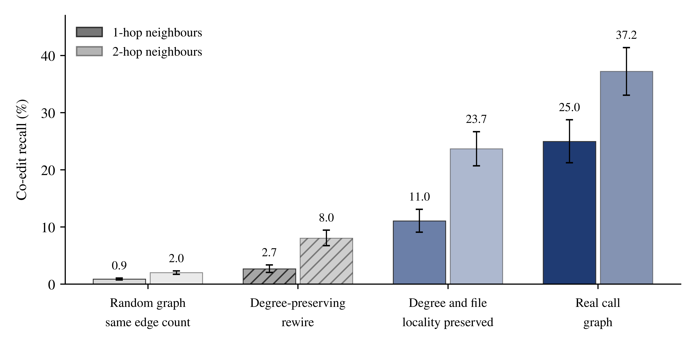

## Abstract

Code-graph tools are now standard equipment for coding agents, and papers credit them with gains in localization and repair. Those gains are measured by switching the tool on and off, which changes the prompt, the tool list and the agent's options along with the graph. GraphNull is a small toolkit that fixes this. Given any call graph and embedding file in the Gemma 4 Developer Agent harness format, it writes null worlds that the harness loads unchanged and that an agent cannot tell apart by interface. Each null removes one kind of information and keeps the rest. The release has four parts: a one-file Python library with four null models and their invariant checks, two public notebooks that validate it on the 127 competition graphs and on 362 commits from three unseen repositories, a benchmark of 109 held-out issue tasks with its builder, and an outcome table of 9,932 agent episodes. On held-out commits a null ladder separates the signal in a call graph cleanly. Real edges put another co-edited function in a function's neighbour list 25.0% of the time. Keeping only each node's degree leaves 2.7%, and keeping degree and file locality leaves 11.0%. Of the 22.3 points that real edges add over the degree null, file locality accounts for 8.4 and the specific call relation for the other 13.9.

## 1 The problem this resource solves

Suppose an agent with a call-graph tool localizes more bugs than the same agent without it. Several things changed at once. The agent has a longer tool list and a different system prompt. It can turn a bare name into a fully qualified symbol. It spends turns on tool calls that it would otherwise spend reading files. The graph's edges are only one of these differences. An honest attribution to the edges needs a control in which everything except the edges is the same.

Network science solved the same problem two decades ago with randomized graphs that keep chosen statistics fixed [1, 2], and the configuration model and its relatives are the standard tools for asking which features of a network matter [3, 4]. Explanation methods for neural networks learned it the hard way when randomization tests showed that some saliency maps did not depend on the model at all [5]. Agent evaluation has not adopted the practice, partly because nobody has packaged it for agent harnesses. GraphNull is that package.

## 2 What is in the release

**Table 1. Components.**

|Component|What it is|Where|
|---|---|---|
|`graphnull.py`|One file, standard library plus numpy. Four null models, invariant checks, harness reader and writer, command line|GitHub `graphnull/`|
|Competition check|Rebuilds the worlds of the case study from the competition data with the library and checks the hash|Kaggle `graphnull-competition-check`|
|Null ladder|Validates all null models on 362 commits from click, flask and attrs|Kaggle `graphnull-ladder`|
|Held-out benchmark|109 issue tasks from merged pull requests that close an issue, with graphs, worlds and hashes|Kaggle `maporritual-heldout-issues`|
|Outcome table|9,932 agent episodes across eight world and prompt conditions, two Gemma 4 models, 120 competition tasks and two held-out task sets, with a notebook that recomputes every reported number|Kaggle `release-b-outcomes-and-analysis`|

Everything is Apache 2.0. No competition data is redistributed; notebooks that read it write only to temporary storage and print counts and hashes.

## 3 Design

**Null models.** Each null fixes a set of invariants and randomizes the rest (Table 2). The degree null uses double-edge swaps [1]. Two edges (a, b) and (c, d) become (a, d) and (c, b) unless that creates a self loop or a duplicate, ten swaps per edge. The stratified null accepts a swap only when a and c share a group and b and d share a group. Then each endpoint trades a neighbour for another from the same group, so every node keeps its degree and its count of neighbours in every group. With the source file as the group, this keeps file locality and scrambles which function in the file is called, in the spirit of degree-corrected block models [4]. The random null keeps only the node set and the edge count. The permuted null keeps the graph and shuffles embedding vectors across nodes, which tests similarity search the same way.

**Table 2. What each null keeps.**

|Null|Nodes and edge count|Every node's degree|Per-file neighbour counts|Embeddings|
|---|---|---|---|---|
|Random|kept|changed|changed|kept|
|Degree|kept|kept|changed|kept|
|Stratified|kept|kept|kept|kept|
|Permuted|kept|kept|kept|shuffled|

**Interface matching.** Worlds are written as directories of graph and embedding files with the original names, in the format the harness's own graph library reads. Tool names, descriptions, node ids and output formats do not change, so a world is selected by pointing the harness at a different directory. Edges are normalized to one undirected type stored in both directions, which is how the competition graphs store calls.

**Determinism.** Every random choice draws from a seed derived from a global seed and the file name, so a world can be rebuilt bit for bit and identified by the hash of its manifest. Building all worlds for the 127 competition graphs takes about 100 seconds on a Kaggle CPU.

**Use.** A complete run is three lines.

```
import graphnull as gn
manifest, digest, report = gn.make_worlds("graphs", "embeddings", "worlds", stratified_group=lambda n: n.rsplit(".", 1)[0])
print(gn.summarize(report), digest)
```

The same is available as `python graphnull.py graphs embeddings worlds --stratify-by-file`. For a single graph, `rewire_degree`, `rewire_stratified`, `random_same_size` and `permute_embeddings` take a pair set and a seed, and `check_null` reports which invariants hold.

## 4 Validation

**Invariants hold everywhere.** On the 127 competition graphs every degree-null graph keeps every node's degree, a median of 97.9% of edges change, and the stratified null keeps degree and per-module profile in all 127 graphs. Its constraint is much tighter there, so it completes a median of 18% of the requested swaps and changes 34.3% of edges. On the 362 held-out commits, 20 nulls of each kind per commit give 7,240 graphs per null. The degree null keeps every degree in all of them and changes a median of 97.6% of edges. The stratified null keeps degree and per-file profile in all of them and changes a median of 67.2%. The random null keeps the edge count and changes almost every edge.

**The library reproduces a published study.** Run on the competition data, the library writes worlds whose manifest hash is 5b88c0e967618d8b, the hash fixed before the confirmatory runs of the case study in Section 5 [6]. The library is therefore the generator those results were obtained with, not a reimplementation.

**The harness cannot tell worlds apart.** Before every held-out run, the harness's own loader read the real and rewired world of each repository and returned the same node count, the same neighbour-list length for a probe node and the same number of similarity results. In the agent runs all three graph tools answered in every world.

**The null ladder separates signal from locality.** For each of the 362 commits that edit between 2 and 10 source functions in click, flask or attrs, we build a static call graph of the parent commit and ask how often the neighbour list of one edited function contains another edited function. Co-edited functions are a reasonable proxy for code an agent would need to find next. Figure 1 and Table 3 show the ladder. The Kaggle run reproduces a local run bit for bit (results hash 216e6e85824757c4).



**Figure 1. Co-edit recall under the real call graph and three nulls, 362 held-out commits, mean with 95% task bootstrap intervals.**

**Table 3. Co-edit recall (%) and differences (pp), 95% intervals.**

|Graph|1-hop|2-hop|
|---|---|---|
|Real|25.0 [21.2, 28.7]|37.2 [33.0, 41.4]|
|Stratified (degree and file locality kept)|11.0 [9.1, 13.1]|23.7 [20.7, 26.7]|
|Degree-preserving|2.7 [2.0, 3.3]|8.0 [6.7, 9.4]|
|Random, same edge count|0.9 [0.7, 1.0]|2.0 [1.7, 2.3]|
|Real minus stratified|+13.9 [11.0, 16.9]|+13.6 [10.8, 16.4]|
|Stratified minus degree|+8.4 [6.5, 10.4]|+15.6 [13.1, 18.2]|

Three things follow. First, the null is not empty. Real edges carry information that scrambling destroys, so a null world is a meaningful control and not a strawman. Second, degree alone explains almost nothing; the degree null sits close to a random graph. Third, file locality explains a real but minority share. In the median commit 67% of call edges stay inside one file, and keeping that structure recovers 11.0% of co-edit recall against 25.0% for the real graph. At one hop, 13.9 of the 22.3 points that real edges add over the degree null belong to the specific call relation; at two hops the split is close to even. A claim that "the graph helps because it encodes calls" should be tested against the stratified null, and a claim that "the graph helps at all" against the degree null. The ladder lets a reader say which.

## 5 Case study

The companion paper *Map or Ritual?* [6] used GraphNull with two Gemma 4 models on 120 competition tasks and 109 held-out issues. The edges carried signal, yet giving agents the real graph instead of a degree-preserving null changed localization accuracy by at most a few points. For the 31B model the two were equivalent within 5 points under every prompt and task set. For E4B a tool ablation would credit the graph with 7.5 points on competition tasks, while the null world showed that 5.3 of them arrive with scrambled edges. Without the null, both results would have been reported as graph-driven gains. The same study found that graph tools surfaced a gold function more often with real edges, which agrees with the ladder and locates the loss downstream, in what the agent does with the result.

## 6 Recommended protocol

Choose the null by the claim. Credit a gain to the graph's existence with the random null, to its structure with the degree null, to call relations beyond file layout with the stratified null, and to embeddings with the permuted null. Run the real world and the null under the same prompt, seeds and tasks, and compare them paired by task. Report an interval and an equivalence margin chosen in advance, so that "no difference" is a finding and not a failure to find one. Publish the manifest hash, so that readers can confirm the worlds.

## 7 Limitations

The library treats a graph as undirected with one edge type, which matches the competition harness but loses direction and edge kinds that richer graphs carry. On the competition graphs the stratified null groups nodes by the module part of the node id, because nodes carry no file field, and the tighter constraint leaves it changing only a third of edges there; on the held-out graphs the group is the real source file and two thirds of edges change. The random null changes degrees and so also changes neighbour-list length, which is why it is a floor and not the main control. The ladder uses our own static call-graph builder, three Python repositories and co-edit recall as a proxy for usefulness; it validates that the nulls remove signal, not that every agent loses accuracy when they do. Tighter nulls exist, such as preserving the joint degree distribution or motif counts [2], and are natural extensions of the same swap interface.

## References

[1] S. Maslov, K. Sneppen. Specificity and Stability in Topology of Protein Networks. Science, 2002.
[2] R. Milo et al. Network Motifs: Simple Building Blocks of Complex Networks. Science, 2002.
[3] B. K. Fosdick et al. Configuring Random Graph Models with Fixed Degree Sequences. SIAM Review, 2018.
[4] B. Karrer, M. E. J. Newman. Stochastic Blockmodels and Community Structure in Networks. Physical Review E, 2011.
[5] J. Adebayo et al. Sanity Checks for Saliency Maps. NeurIPS 2018.
[6] Yerramsetty Sai Venkata Suchita, Manjunath Mailey, Kanuma Jagan Mohan. Map or Ritual? Null-World Tests of Code-Graph Tools for Gemma 4 Coding Agents. Kaggle Gemma 4 Developer Agent Paper Track, 2026.
